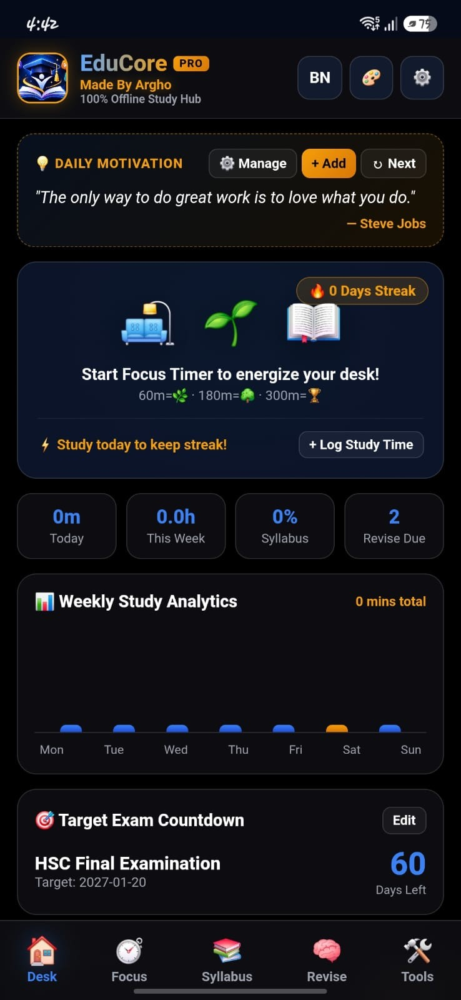
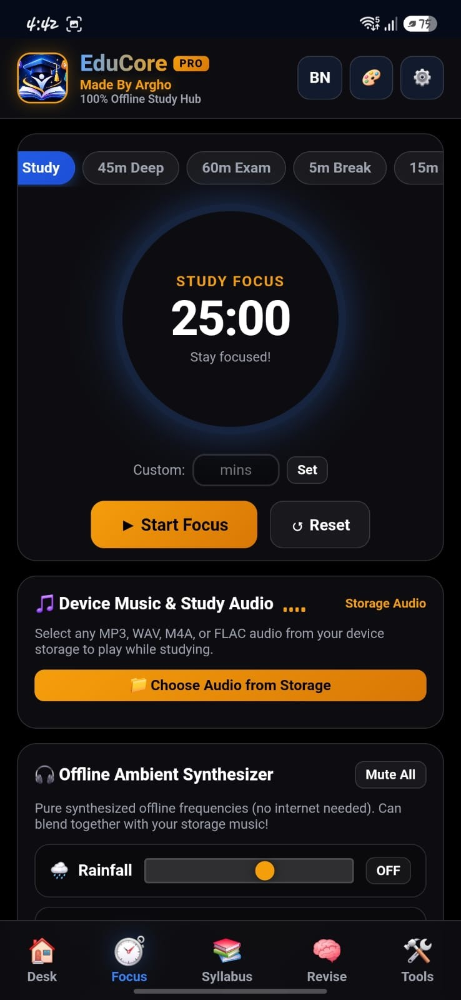
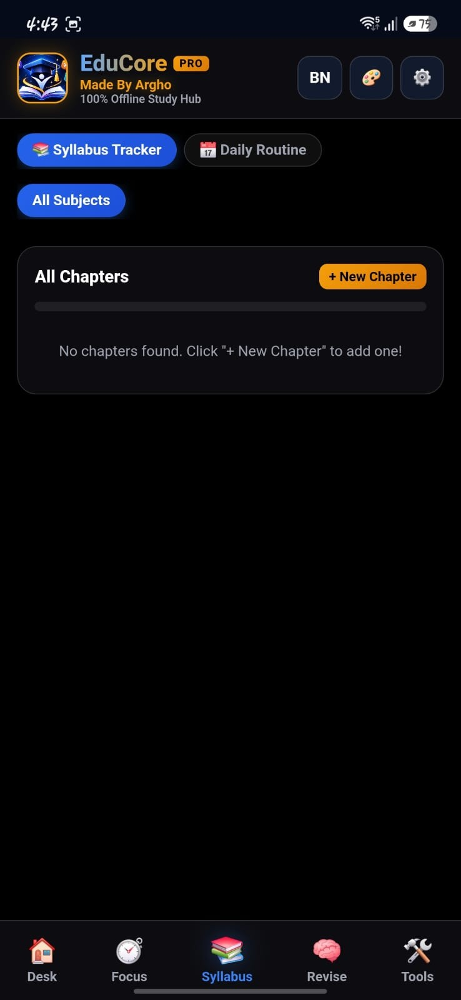
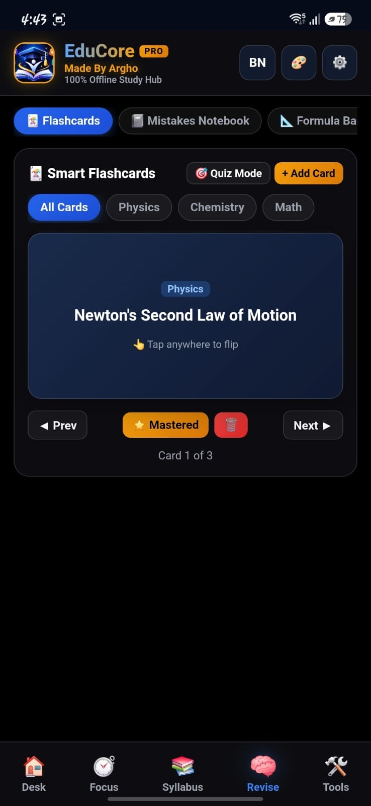
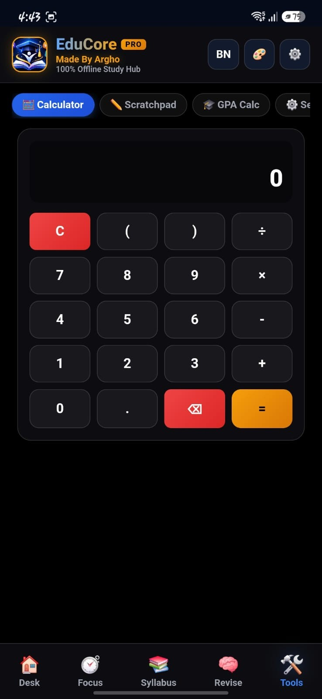
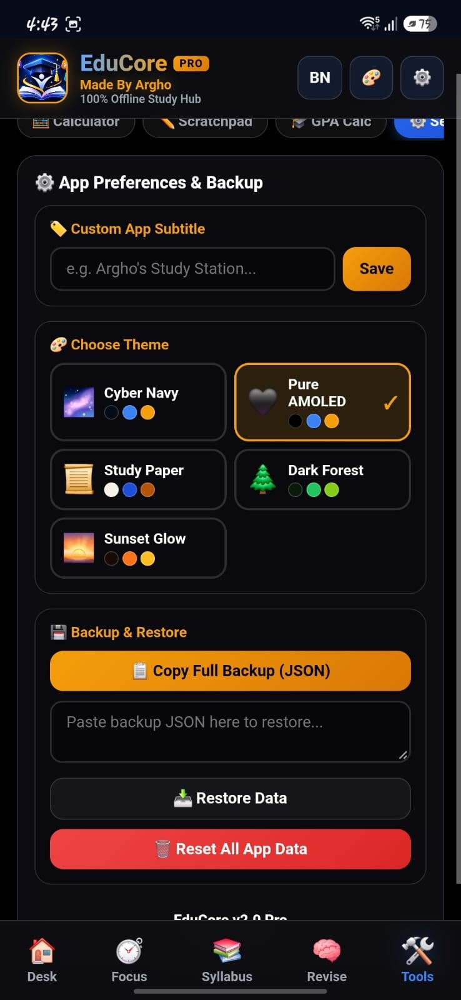

# EduCore PRO

**A personal study hub for focused learning, revision, and academic planning.**

EduCore PRO is an Android study companion presented as a 100% offline study hub. It brings study planning, focus sessions, revision tools, and everyday academic utilities together in one dark-themed interface.

> **Current package:** EduCore PRO v2.0  
> **Developer:** Argho  
> **Platform:** Android  
> **App format provided:** APK

## Screenshots

| Study dashboard | Focus timer |
|---|---|
|  |  |

| Syllabus tracker | Revision tools |
|---|---|
|  |  |

| Study tools | Settings and backup |
|---|---|
|  |  |

## Features

### Study dashboard
- Daily motivation section
- Study streak and study-time summary
- Weekly study analytics
- Target exam countdown

### Focus timer
- Study, Deep Focus, Exam, and Break timer presets
- Custom timer duration
- Device audio selection
- Offline ambient sound synthesizer

### Syllabus and revision
- Syllabus tracker with subject and chapter organization
- Smart flashcards
- Quiz mode
- Mistakes notebook

### Academic tools
- Calculator
- Scratchpad
- GPA calculator

### Personalization and data
- Multiple visual themes, including Pure AMOLED
- Custom app subtitle
- JSON backup and restore controls

## Download

The Android APK is published through the project's GitHub Releases.

**[Download the latest EduCore PRO APK](https://github.com/alindodhar/EduCore-Pro/releases/latest/download/EduCore-v2.0-Pro.apk)**

If the link is not active yet, publish a GitHub Release and attach the file named `EduCore-v2.0-Pro.apk`.

## Installation

1. Download the APK from the Releases section.
2. Open the downloaded APK on your Android device.
3. Follow Android's installation prompts.
4. Launch EduCore PRO.

Only install APK files that you trust and that come from the project's official release page.

## Repository contents

- `screenshots/` — app screenshots used in this README
- `release-assets/` — APK file to attach to a GitHub Release

The repository package currently contains the distributable APK and screenshots. Android source code and build instructions have not been supplied in this release package.

## Developer

**Made by Argho**

- GitHub: [@alindodhar](https://github.com/alindodhar)

---

  EduCore PRO · Study smarter, stay focused.

